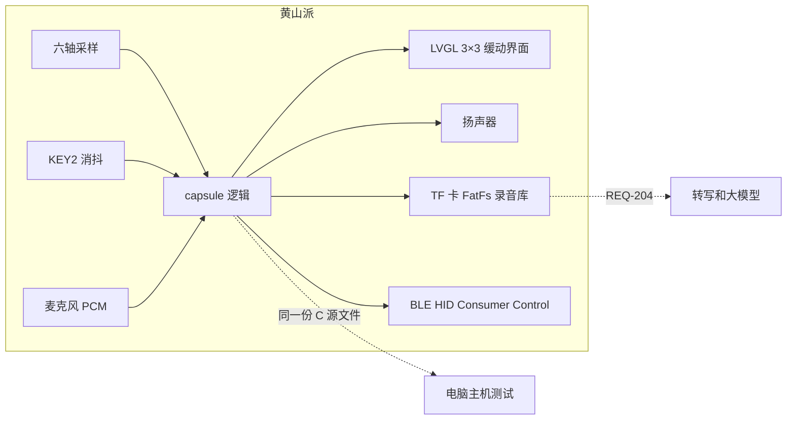
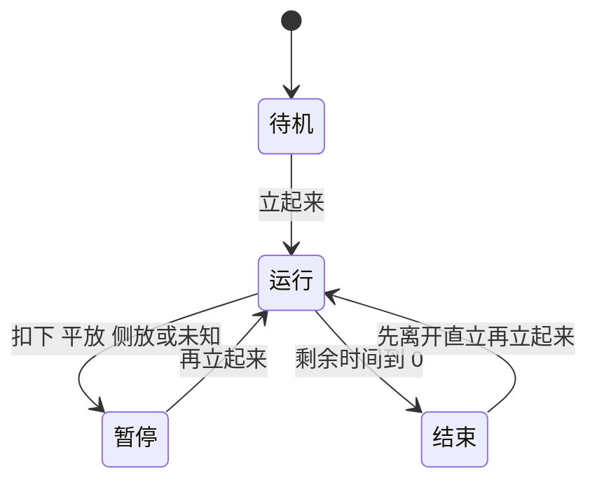
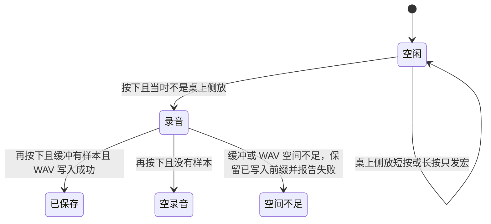

# 方案设计说明

| 项 | 内容 |
|---|---|
| 文档编号 | DOC-02 |
| 项目名称 | 闪念胶囊 |
| 版本 / 状态 | v0.5 / 草稿 |
| 负责人 / 日期 | 待填写 / 2026-11-06 |

## 修订记录

| 版本 | 日期 | 修改人 | 修改内容 | AI参与 |
|---|---|---|---|---|
| v0.2 | 2026-11-02 | 待填写 | 按 REQ 编号写模块、状态机和板上接法 | 是 |
| v0.3 | 2026-11-06 | 待填写 | 方案更新为 pose-driven-ui 架构（双模式计时、去 VAD 完整 raw PCM 录音与 TF 卡库、BLE HID、3×3 缓动 UI）；明确开发阶段不跑测试，待用户统一手动验收 | 是 |
| v0.4 | 2026-11-06 | 待填写 | 接入 AddLCPU 镜像嵌入与 BLE HID 六项控制规范；更新官方板级引脚映射（IMU PA40/PA39，触摸 PA37/PA33）；更新 35 秒串口验证状态（0 错误/超时、广播已发现、配对认证失败）；明确未实测物理项目 | 是 |
| v0.5 | 2026-11-06 | 待填写 | 更新 BLE HID 验证状态：通过 BlueZ NoInputNoOutput agent 成功配对与绑定（Bonded: yes, ServicesResolved: yes），解析出 HID 0x1812 服务与特征值；明确媒体按键报告接收、物理屏幕视觉、触控点击、蜂鸣与录放音仍待手动验收 | 是 |

## 1. 设计输入

- 需求来源：`01-需求规格说明.md` v0.2
- 硬件平台：黄山派 SF32LB525UC6，板型 sf32lb52-lchspi-ulp；SDK 版本 v2.5.1
- 约束：无 WiFi。套件不含 TF 卡、电池和马达。逻辑不调用传感器、屏幕和蓝牙，方便在电脑上测试。

## 2. 总体架构

黄山派负责姿态检测、双模式倒计时、去 VAD 完整 PCM 录音、TF 卡文件管理、BLE HID 遥控、3×3 姿态缓动 UI 与串口状态输出。固件集成 LVGL v8 交互页面、FT6146 触控、BLE Consumer Control HID（音量加减、静音、上一首、播放/暂停、下一首六项控制）与 SPI1 TF 录音库（含文件选择与背压保护及 UI 状态反馈）；构建脚本通过 AddLCPU 嵌入 LCPU 镜像以驱动 BLE 控制器。固件已完成 SDK 构建、串口 verify 刷写并通过 RTS 复位启动。串口日志显示 boot ok、自检 PASS、IMU ready、UI ready，35 秒连续串口捕获中无 I2C 错误或超时；板端 BLE 广播正常，主机启动常驻 BlueZ NoInputNoOutput agent 并清除旧设备后成功完成配对与绑定（Bonded: yes、ServicesResolved: yes），解析出 HID 服务 0x1812 及特征值；实际媒体按键报告接收、屏幕视觉、触控点击、蜂鸣与录放音仍待实机物理验收。

`src/SConscript` 把 `capsule/src` 与 `src/main.c`、`src/tf_library.c`、`src/ble_hid.c` 编在一起。`main` 初始化 IMU、固定五姿态参照、KEY2、audio_server、提示音、TF 卡库、BLE HID 与 LVGL 触控界面；触摸事件通过命令队列发送至主线程处理。

## 3. 模块划分与需求追踪

| 模块 | 职责 | 对外接口 | 实现的需求 | 代码路径 | 测试 |
|---|---|---|---|---|---|
| pose | 标定向量、余弦相似、64 字节导入导出、毫 g 换算 | `capsule_pose_match`、`capsule_accel_millig`、`capsule_pose_map_export` | REQ-001、REQ-102、REQ-103 | `capsule/src/pose.c` | TC-001 |
| 计时 | 双模式倒计时（番茄钟与普通倒计时）、时长调节、运行、暂停、结束与提示音开关 | `capsule_on_time`、`capsule_set_timer_mode`、`capsule_set_timer_minutes`、`capsule_set_beep_enabled` | REQ-002、REQ-003、REQ-006 | `capsule/src/capsule.c` | TC-002、TC-003、TC-006 |
| 按键策略 | KEY2 录音或宏；桌上状态判定 | `capsule_record_start`、`capsule_record_stop`、`capsule_on_key_down`、`capsule_on_key_up` | REQ-004、REQ-005 | `capsule/src/capsule.c` | TC-004、TC-005 |
| wav | 16 kHz 单声道读写 | `capsule_wav_write`、`capsule_wav_read` | REQ-004、REQ-104 | `capsule/src/wav.c` | TC-004 |
| 自检 | 启动时跑几条不碰硬件的检查 | `capsule_selftest` | REQ-102 | `capsule/src/selftest.c` | TC-007 |
| 界面 | 3×3 页面网格（390×450），计时居中、两侧遥控、平放录音，姿态驱动缓动动画与转场重定向，FT6146 触控接入 | LVGL 页面容器、动画与触控命令队列 | REQ-006 | `src/main.c` | TC-006 |
| TF 录音库 | SPI1 FatFs 录音落盘，支持多文件切换、播放和双击删除确认，包含选择与背压保护及 UI 状态反馈，无卡回退 RAM | `tf_library_init`、`tf_library_save`、`tf_library_next`、`tf_library_play`、`tf_library_delete` | REQ-201 | `src/tf_library.c` | TC-201 |
| BLE HID | Consumer Control HID 发送音量加、音量减、系统音频静音、上一首、播放/暂停、下一首六项控制 | `ble_hid_init`、`ble_hid_send` | REQ-202 | `src/ble_hid.c` | TC-202 |
| BLE 文件传输 | 自建 128-bit GATT（cmd 写、data 通知）：`V` 版本、`L` 列表、`G` 拉取；按 MTU 自适应分块、hex 分帧、录音/回放忙时拒绝 | `ble_file_init`、`ble_file_connected`、`ble_file_transfer_active` | REQ-203 | `src/ble_file.c` | TC-203 |
| 转写待办（PC） | 主机端流水线：转写（whisper/openai/mock）+ 待办抽取（rules/llm/mock），输出 `todos.md`/`transcript.json` | `todo_pipeline.py` | REQ-204 | `tools/todo_pipeline/` | TC-204 |
| 采样时序 | 调用方保证周期 | 文档约定 | REQ-101 | `capsule/README.md` | TC-101 |
| 模型 / 外壳 | 本期不实现 | 无 | REQ-205、REQ-206 | 无 | 无 |

## 4. 接口设计

### 4.1 软件接口

调用顺序和缓冲大小见 `capsule/README.md`。各接口共用同一个毫秒时钟。

| 接口 | 输入 | 输出 | 错误处理 | 说明 |
|---|---|---|---|---|
| `capsule_init` | PCM 与 WAV 缓冲 | 0 或 -1 | 容量不够或地址奇数则失败，不改结构体 | REQ-104 |
| `capsule_capture` | 姿态枚举 | 0 或 -1 | 没有样本或不是静止重力时不覆盖 | REQ-001 |
| `capsule_pose_map_import` | 64 字节 | 0 或 -1 | 失败不改原表 | REQ-103 |
| `capsule_on_accel` | 毫 g 和时间 | 无 | 时间倒退则整拍丢掉 | REQ-002 |
| `capsule_on_pcm` | PCM | 0 或 -1 | 移除 VAD，完整追加 raw PCM；写满报告 `CAPSULE_MEMO_NOSPACE` | REQ-004 |
| `capsule_take_beep` | 无 | 是否该响提示音 | 取走后清除；若提示音配置为关则不置位 | REQ-003 |
| `capsule_set_timer_mode` | 计时模式枚举与当前时间 | 0 或 -1 | 切换模式并加载该模式在 RAM 中的剩余时间，运行中平滑衔接 | REQ-002 |
| `capsule_set_timer_minutes` | 预设分钟数与当前时间 | 0 或 -1 | 范围 1–120 分钟，支持 1 分钟步进；运行中按预设差值调整当前剩余时间 | REQ-002 |
| `capsule_set_beep_enabled` | 提示音开关布尔值 | 无 | 控制计时归零时是否触发提示音 | REQ-003 |

### 4.2 数据结构与状态机

姿态要先稳定 400 ms。下面的“立起来”都指稳定之后的直立。

结束提示在进入结束时置位。扣下会清掉还没取走的提示，并把静音设为真。走完和扣下落在同一拍时也一样。平放和侧放只暂停，并取消静音。未知暂停并取消静音，不吞掉已经置位的提示。时间戳倒退时这一拍丢掉，加速度读数也不改。

计时时长调节与长按加速：
- 计时范围 1–120 分钟，步进 1 分钟。
- 触控 +/- 按钮响应短按与持续按住。短按触发 `LV_EVENT_SHORT_CLICKED` 调整 1 分钟；持续按住约 0.5 秒（500 ms）后进入自动连续调节，重复间隔根据按住时长阶梯缩短：前 2 秒为 250 ms，满 2 秒缩短至 120 ms，满 4 秒缩短至 60 ms；长按释放时忽略 `LV_EVENT_CLICKED`，避免产生多余的释放步进；到达 1 分钟或 120 分钟边界时自动钳位。
- 运行中调节预设值时，当前剩余时间按预设差值同步联动增减。

结束提示音与音频调度：
- 提示音采用 1000 Hz 正弦分块波形，峰值振幅为 30000，持续输出 50 个 10 ms 分块（共 500 ms）。
- 在调用 `audio_open` 前预先配置 `AUDIO_TYPE_LOCAL_MUSIC` 私有音量为 15。
- 播放过程由独立工作线程 `timer_beep` 异步调度，避免写入等待阻塞主事件循环与 LVGL 刷新。
- 音频写入维护分块内的字节偏移累加，写入返回 0（缓存满）时执行延时重试。数据写入完成后通过 `AUDIO_IOCTL_FLUSH_TIME_MS` 查询排空耗时，并追加 50 ms 尾部保护延时，防止硬件功放提前断电截断尾音。
- 扣下静音或关提示音时清除主循环待响标记；录音或回放活跃时避免音频通道冲突。实际发声效果仍需实机确认。

录音和计时互不取消。

按下开始之后，松手不结束；再次按下才停止。移除 VAD 静音裁剪，停止时完整保留录到的 raw PCM，包括开头、中间和结尾静音；全静音非空录音生成合法 WAV；零样本标记为空。缓冲区写满则自动停止录音并保留已写内容，通过 `CAPSULE_MEMO_NOSPACE` 报告空间不足。TF 卡可用时自动存为独立文件；无卡或写入失败回退 RAM 并提示未持久化。

桌面标记：稳定的直立、平放、扣下会打开它。侧放不改变它。稳定的未知持续满 3 秒后关掉。关掉之后，侧放也录音。

加速度先换成毫 g，再和五个参照比方向。相似度用千分比，1000 表示同向。低于 850，或第一名和第二名差距小于 80，结果是未知。样本合加速度不在 0.4 g 到 2.5 g 之间，也是未知。

麦克风 PCM 是有符号 16 位、16000 Hz、单声道。移除静音检测、底噪估计、静音裁剪和语音判断，直接把完整 raw PCM 写入 WAV。

## 5. 硬件资源分配

| 外设 | 用途 | 引脚/总线 | 参数 | 来源 |
|---|---|---|---|---|
| LSM6DS3TR-C | 姿态 | I2C1（PA40/PA39），I2C 地址 0x6A | 加速度是寄存器 0x22 起 12 字节里的后 6 字节，小端，再经 `capsule_accel_millig` | 官方板级引脚表 |
| KEY2 | 录音或宏 | PA43，按下为高 | 调用前先消抖。按住期间重复按下忽略 | 课程按键示例 |
| KEY1 | 不用 | PA34 | 与电源、长按复位复用 | 课程说明 |
| PA43 唤醒 | 不采用小智的休眠开机 | PMU wakeup 0 | 小智移植在关机流程里把 PA43 当唤醒脚。本期不进入该流程 | `xiaozhi-sf32` 的 `sf32lb52-lchspi-ulp.cc`，只作对照 |
| 麦克风 | 录音 | 板载 MEMS | 16 kHz、单声道、16 bit，只开 MIC0，关掉上行 AGC。小智的录音路径也是 16 kHz | 课程录音示例；小智 `xiaozhi_audio.c` 作对照 |
| 扬声器 | 结束提示和回放 | 只插丝印 SPK | capsule_take_beep 为真时由独立工作线程异步播放 500 ms 提示音（音量 15）；回放播放 WAV | 板卡丝印 |
| 屏幕与触摸 | 3×3 姿态缓动页面与触控 | QSPI AMOLED，LVGL v8；390×450 网格；FT6146 触控使用独立映射引脚（PA37/PA33），IMU 保持 PA40/PA39 不变；扣下控制背光熄灭并在已知姿态恢复 | REQ-006 |
| TF 卡槽 | 多条 WAV 文件库 | SPI1：PA24/PA25/PA28/PA29；PA27 检测；无卡或写失败回退 RAM | REQ-201 |
| 蓝牙 | Consumer Control HID | SF32LB52 Rev 3 板载 BLE，依赖 AddLCPU 嵌入 lcpu_general 固件镜像。支持音量加、音量减、系统音频静音、上一首、播放/暂停、下一首六项控制，本地功能独立 | REQ-202 |

## 6. 软件运行设计

- 采样、按键、录音在主线程/音频回调协作；音频回调只复制 PCM，录音停止和 WAV 处理在主线程完成。
- 逻辑接口不是线程安全的，不要在中断里调用。宏和按键事件通过消息队列交给主线程处理。
- 采样 100 ms。`capsule_on_time` 使用同一毫秒时钟。
- 30 秒 PCM 约 960 KB，放 PSRAM；录音截断标记放在状态结构中。
- UI 在独立任务中运行，LVGL 只由该任务访问；FT6146 触摸配置已启用，与 IMU 分别使用官方板级引脚（触摸 PA37/PA33，IMU PA40/PA39）。连续 35 秒串口捕获中 I2C 传输错误与超时均为 0；物理触摸点击与并发稳定性留待实机确认。
- 3×3 页面网格（390×450）在稳定姿态变化后以 260 ms 缓动动画（`lv_anim_path_ease_out`）滑动至目标；转场中收到新目标姿态时直接以当前坐标偏移为起点平滑滑向最新目标，不排队。未知姿态不触发转场，扣下隐藏显示内容。
- 核心逻辑回归通过 `make -C capsule test` 283 项检查；提取回调与音频循环的冒烟套件通过正常播放、打开/写入/排空失败分支及长按阶梯加速验证。硬件固件构建必须通过 `AddLCPU` 将 LCPU 镜像编译嵌入主镜像。清理缓存后的正式固件已通过 UART verify 成功刷写（exit code 0）并由 RTS 复位启动；自检 PASS，IMU、FT6146 和 UI 初始化正常，板端 BLE 广播成功启动，连续 25 秒零 I2C 错误/超时。主机配置常驻 BlueZ `NoInputNoOutput` agent 配对绑定成功解析 HID 0x1812 服务；临时硬件探针证实模式 0 与模式 1 到期均触发目标板实际 `play_beep`、AW8155 功放启动与 `timer beep emitted`（探针已撤除）；实际媒体按键报告接收、物理屏幕视觉、触摸交互及扬声器实际声学听感留待统一手动验收。
## 7. 关键技术选型与决策

| 决策 | 备选方案 | 选择理由 | 决策人 | ADR |
|---|---|---|---|---|
| 必达范围与拓展支持 | 引入整套小智语音框架 | 移除重型外部依赖，自研双模式计时、去 VAD 录音、TF 卡库、BLE HID 与 3×3 缓动 UI | 学生确认 | `adr/0001-必达范围.md` |
| 录音去 VAD 保留完整 PCM | 能量门限 VAD 或神经网络 VAD | 避免静音裁剪误切和底噪估计不稳定，桌面场景直接保存完整音频 | 架构决策 | 见需求第 6 节 |
| 功能键用 KEY2 | 改用 KEY1，或照搬小智的 PA43 唤醒开机 | 课程示例已经把 KEY2 当功能键 | 学生确认 | 见需求第 6 节 |

## 8. 非功能设计

- 功耗：本期不测。桌面用 USB。
- 性能：姿态窗口 400 ms，按键长按 600 ms。没有帧率指标。
- 资源：见 REQ-104。WAV 最长等于调用方给的缓冲。
- 可靠性：倒退时间戳不能把倒计时一次走完。导入失败不覆盖原标定。

## 9. 风险与备选方案

| 风险 | 概率 | 影响 | 应对 / Plan B | 台账编号 |
|---|---|---|---|---|
| 本机没有 SDK，固件不能在这里编译 | 高 | 高 | 主机测试先锁逻辑。换到有 SDK 的环境再编 | R-01 |
| 板端行为与主机不一致 | 中 | 高 | B1 到 B9 未执行就不算通过 | R-02 |
| 若以后要休眠，PA43 会被唤醒占用 | 低 | 中 | 本期不休眠。要做口袋开关机时再单独立项 | R-03 |

## 10. 需求覆盖

REQ-001 到 REQ-006、REQ-101 到 REQ-104，以及拓展需求 REQ-201（TF 卡）、REQ-202（BLE HID）已在代码中实现，留待统一手动验收。

REQ-203（蓝牙传文件）：板端 `src/ble_file.c` 已接入 `main()`、编译通过，主机端 `tools/ble_memo_sync/` 离线端到端通过，真机 S3–S6 待上板；
REQ-204（转写待办）：PC 侧 `tools/todo_pipeline/` 已实现并自检 13 项，真实语音转写待补模型/凭据；
REQ-205（片内 NN VAD）、REQ-206（外壳）仍未实现。
